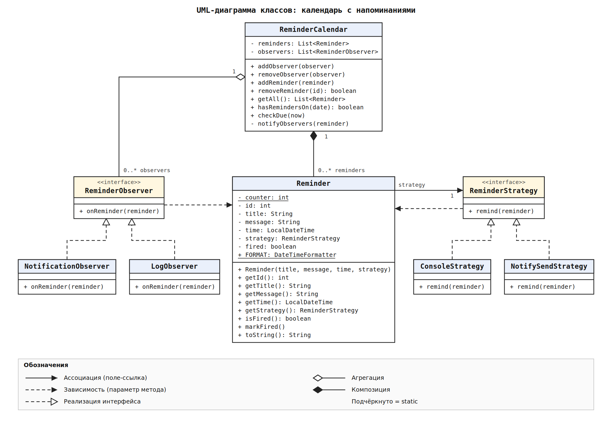
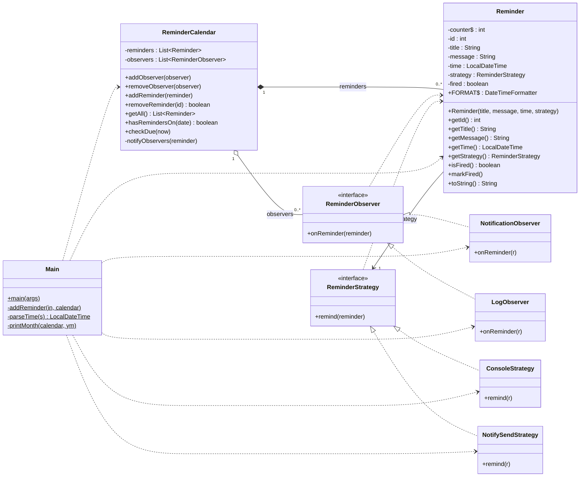

# Календарь с напоминаниями (Java)

Консольный календарь, в который можно добавлять напоминания.
Когда наступает время напоминания, программа уведомляет пользователя.

- **Наблюдатель (Observer)** отвечает за _рассылку события_ «пора напомнить».
- **Стратегия (Strategy)** отвечает за _способ напоминания_ (консоль, `notify-send`).

Внешних библиотек нет, используется чистая Java.

## Возможности

- Показ месяца в консоли. Дни, в которые есть напоминания, помечены `*`. Месяцы листаются командами `n` и `p`.
- Добавление напоминания: заголовок, текст, время и способ уведомления.
- Просмотр списка напоминаний и удаление по ID.
- Автоматическое срабатывание в нужное время:
    - текстом в консоль
    - системным уведомлением через `notify-send` (пока только Linux)

## Требования

- Java 14+.
- Для уведомлений: `notify-send` (пакет `libnotify`) и запущенный демон уведомлений (dunst, mako, swaync, GNOME/KDE и т. д.).
  Если `notify-send` не найден, программа не падает, а выводит сообщение в консоль.

## Запуск

```bash
cd src
javac *.java
java Main
```

### Пример сессии

```
OCTOBER 2026
 Пн  Вт  Ср  Чт  Пт  Сб  Вс
             1   2   3   4
 5   6   7   8   9  10  11
12  13  14  15  16  17  18
19  20  21  22  23  24  25
26  27  28  29  30  31
(* — в этот день есть напоминания)

1 - добавить | 2 - список | 3 - удалить | n/p - след./пред. месяц | 0 - выход
> 1
Заголовок: ООП
Текст: Пора выполнить задание по ООП!
Когда? (yyyy-MM-dd HH:mm, либо +N минут, либо +Ns секунд): +10s
Способ: 1 - консоль, 2 - notify-send: 2
Добавлено: #1 [2026-10-28 18:52:10] ООП — Пора выполнить задание по ООП!
```

Через 10 секунд появится системное уведомление, а в консоли строка лога:

```
[LOG 2026-10-28T18:52:10] сработало #1 "ООП"
```

### Форматы времени

| Ввод               | Значение                |
| ------------------ | ----------------------- |
| `2026-11-01 09:30` | конкретная дата и время |
| `+5`               | через 5 минут           |
| `+10s`             | через 10 секунд         |

## Структура проекта

| Файл                        | Роль                                                              |
| --------------------------- | ----------------------------------------------------------------- |
| `Main.java`                 | Точка входа: консольное меню, вывод месяца, таймер                |
| `Reminder.java`             | Напоминание: заголовок, текст, время, стратегия, флаг «сработало» |
| `ReminderCalendar.java`     | **Субъект** паттерна Observer: хранит напоминания и наблюдателей  |
| `ReminderObserver.java`     | Интерфейс **наблюдателя**                                         |
| `NotificationObserver.java` | Наблюдатель: отправляет уведомление через стратегию напоминания   |
| `LogObserver.java`          | Наблюдатель: пишет в консоль, что напоминание сработало           |
| `ReminderStrategy.java`     | Интерфейс **стратегии** (как напомнить)                           |
| `ConsoleStrategy.java`      | Стратегия: текст в консоль                                        |
| `NotifySendStrategy.java`   | Стратегия: системное уведомление через `notify-send`              |

## Как работают паттерны

### Observer (Наблюдатель)

| Роль в паттерне        | Класс                                 |
| ---------------------- | ------------------------------------- |
| Субъект (Subject)      | `ReminderCalendar`                    |
| Интерфейс наблюдателя  | `ReminderObserver`                    |
| Конкретные наблюдатели | `NotificationObserver`, `LogObserver` |

Ход событий:

1. В `Main` создаётся календарь, и к нему подключаются наблюдатели (`addObserver`).
2. Фоновый таймер раз в секунду вызывает `calendar.checkDue(LocalDateTime.now())`.
3. `checkDue` перебирает напоминания. Если время наступило и напоминание ещё не срабатывало, оно помечается как сработавшее (`markFired`), и вызывается `notifyObservers`.
4. `notifyObservers` вызывает `onReminder(reminder)` у каждого подключённого наблюдателя.

Календарь ничего не знает о конкретных наблюдателях, он знает только интерфейс `ReminderObserver`. Поэтому нового наблюдателя (запись в файл, звук и т. д.) можно добавить, не меняя `ReminderCalendar`.

### Strategy (Стратегия)

| Роль в паттерне      | Класс                                   |
| -------------------- | --------------------------------------- |
| Контекст (Context)   | `Reminder` (хранит поле `strategy`)     |
| Интерфейс стратегии  | `ReminderStrategy`                      |
| Конкретные стратегии | `ConsoleStrategy`, `NotifySendStrategy` |

Способ напоминания выбирается для каждого напоминания отдельно, при его создании. `NotificationObserver` не знает, как именно напоминать, он просто вызывает `reminder.getStrategy().remind(reminder)`. Это и есть связка двух паттернов: **Observer решает, когда сообщить, Strategy решает, как.**

`NotifySendStrategy` запускает процесс через `ProcessBuilder("notify-send", заголовок, текст)`. Аргументы передаются напрямую, без shell, поэтому спецсимволы в тексте не опасны.

### Потокобезопасность

Таймер работает в отдельном потоке, а пользователь одновременно добавляет и удаляет напоминания. Поэтому методы `ReminderCalendar` помечены `synchronized`, чтобы список не менялся во время обхода.

## UML-диаграмма классов



`Main` на диаграмме не показан, потому что большой. Он создаёт и использует все остальные классы (зависимость).

Пояснение к связям:

| Связь                                                                          | Почему именно такая                                                                          |
| ------------------------------------------------------------------------------ | -------------------------------------------------------------------------------------------- |
| `ReminderCalendar` ◆— `Reminder` (композиция)                                  | Календарь создаёт и хранит напоминания. Нет календаря, нет и его напоминаний.                |
| `ReminderCalendar` ◇— `ReminderObserver` (агрегация)                           | Наблюдатели создаются снаружи и только подключаются. Они существуют независимо от календаря. |
| `Reminder` → `ReminderStrategy` (ассоциация)                                   | У напоминания есть поле `strategy`.                                                          |
| `ReminderObserver` ⇢ `Reminder`, `ReminderStrategy` ⇢ `Reminder` (зависимость) | `Reminder` приходит как параметр метода (`onReminder`, `remind`). Поля такого типа нет.      |
| конкретный класс ⇢▷ интерфейс (реализация)                                     | `implements`. Это пунктирная линия с пустым треугольником.                                   |

### Та же диаграмма в Mermaid


